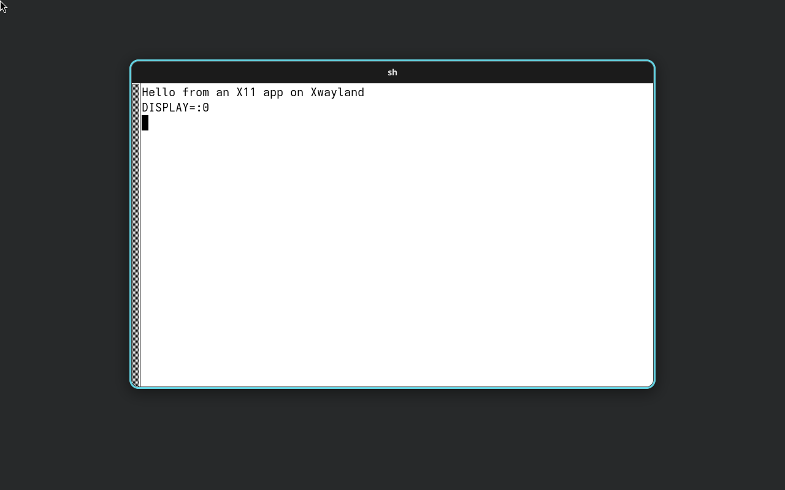

# C1 base image

The Atos base image is a bootc container image (D-008): a **sealed composefs image**, with a UKI and systemd-boot signed by a **test** Secure Boot key. It is built from [`components/c1-base/Containerfile`](../../../components/c1-base/Containerfile) by [`.github/workflows/c1-base.yml`](../../../.github/workflows/c1-base.yml).

## Base

| | |
| --- | --- |
| Image | `quay.io/fedora/fedora-bootc:45`, built from our mirror `ghcr.io/jens-thomae/atos/fedora-bootc:45.20261108.0` ([base-mirror.md](base-mirror.md)) |
| Pinned digest | `sha256:0c0d822e8545efe843e72f4a216295e9fd3d8a8213709fff0db6844b5d9aad29` (multi-arch index, same in both) |
| Version label | `45.20261108.0` (kernel not re-checked after the bump) |
| Size | 65 layers, about 1.04 GB compressed (amd64) |

The digest changes only through a reviewed change to the `ARG BASE=` and `# upstream:` lines; a bump also needs a run of the mirror workflow ([base-mirror.md](base-mirror.md#bumping-the-base)). CI builds amd64 only.

## Our layers

The [`Containerfile`](../../../components/c1-base/Containerfile) follows upstream's recipe, [bootc-sealed-images(7)](https://bootc.dev/bootc/building/bootc-sealed-images.7.html), in stages:

0. **`comp`** (not shipped): builds `atos-comp` (C2) from `components/c2-compositor/` on the same Fedora base with the pinned toolchain (`rust-toolchain.toml`, rustup-init pinned by version). Only the stripped binary is copied into `base`; the toolchain and `target/` are deleted in the same step, because they do not fit the runner's disk as a layer.
0. **`bootc`** (not shipped): builds `bootc` from the upstream tag in `third_party/bootc/UPSTREAM` with our patches (boot counting, #56; version floor, #75), and runs their unit tests. Only the stripped binary goes into `base`, where it replaces `/usr/bin/bootc`. See [boot-counting.md](boot-counting.md).
0. **`nvidia`** (not shipped): builds NVIDIA's open kernel modules from the tag in `components/c1-base/nvidia/UPSTREAM` against exactly the base image's kernel and signs them with the TEST db key. Only the four signed `.ko` files go into `base`. See [nvidia.md](nvidia.md).
1. **`base`**
   - `systemctl mask rpm-ostree-countme.timer`: turns off Fedora's anonymous countme counter (D-005). CI checks that `systemctl is-enabled` reports `masked`.
   - Installs `systemd-boot-unsigned` and removes `bootupd`, `shim-*` and `grub2-efi-*`. Sealed images boot systemd-boot signed with our key, not Fedora's shim and GRUB (D-014). Without bootupd, `bootc install` picks systemd-boot.
   - [`usr/lib/bootc/install/80-atos-rootfs.toml`](../../../components/c1-base/usr/lib/bootc/install/80-atos-rootfs.toml): the root filesystem is ext4. Sealing needs fs-verity, and XFS, Fedora's default, has none.
   - [`usr/lib/bootc/kargs.d/10-atos-rw.toml`](../../../components/c1-base/usr/lib/bootc/kargs.d/10-atos-rw.toml): `rw`, as bootc's own sealed test images use. composefs keeps `/usr` read-only.
   - The test keys' `PK.auth`, `KEK.auth` and `db.auth` in `/usr/lib/bootc/install/secureboot-keys/auto/`. `bootc install` copies them to the ESP as `loader/keys/auto/`.
   - Trust policy (#75): `usr/share/containers/policy.json`, `usr/share/containers/registries.d/atos.yaml`, `usr/lib/bootc/install/85-atos-sigpolicy.toml` and the TEST cosign key as `/usr/share/pki/containers/atos-c1-base-test.pub`. See [trust-policy.md](trust-policy.md).
   - Apps (#187, below): `flatpak` with Flathub as the system-wide remote, Fedora's OCI remotes masked, the Flatpak-Os-Info header off.
   - The session (below): `greetd`, Xwayland, Mesa, `xterm`, `session/` (greetd config, session wrapper, `atos` user), `atos-comp` copied from the `comp` stage and `atos-shell` (C3) from the `shell` stage.
   - NVIDIA graphics (D-017, #162): NVK, NVIDIA's userspace and GSP firmware from RPM Fusion nonfree (pinned, unmodified), the signed modules from the `nvidia` stage, driver selection (`usr/lib/modprobe.d/atos-nvidia.conf`) and the suspend services. See [nvidia.md](nvidia.md).
   - Boot counting (#56): the patched `bootc`, the health check `atos-session-check.service` (enabled), a timeout drop-in for `boot-complete.target`, one SELinux rule for `systemd-bless-boot`, the karg `panic=10` (`kargs.d/20-atos-panic.toml`), and emergency drop-ins that reboot on a counted boot. The initramfs that carries those drop-ins is rebuilt in the `kernel` stage ([boot-counting.md](boot-counting.md)).
   - Label `org.opencontainers.image.title=Atos base`.
2. **`tools`** (not shipped): `systemd-ukify` and `sbsigntools`, plus the test db key.
3. **`sdboot`**: signs `systemd-boot*.efi` as `*.efi.signed`. `bootctl install` prefers the `.signed` file.
4. **`kernel`** (not shipped): rebuilds the initramfs with Fedora's dracut config plus ours (#56) and checks it carries the emergency drop-in and no NVIDIA or nouveau module (#162), then `bootc container split-kernel-and-rootfs` moves the kernel and initramfs to `/kernel/<kver>/`. Only the `uki` stage reads them, through a bind mount.
5. **`rootfs`**: the tree that gets sealed, built `FROM base`. This stage does four things:
   - Puts the signed systemd-boot into `/usr`.
   - Runs `split-kernel-and-rootfs` again and deletes its output in the same layer, so the layer only records that the kernel and initramfs are gone from `/usr/lib/modules/<kver>/`. No layer of the image carries a copy (#111); upstream bootc's own Dockerfile does the same. The example in bootc-sealed-images(7) builds the final image on top of the split stage, which ships the split-out files in a layer even where a later layer deletes them.
   - Sets every directory's mtime to the epoch, as the base image already has it. Without this, the digest computed from the filesystem at build time differs from the one `bootc install` computes from the OCI layers for every directory our layers touched, and the install fails with *"embedded composefs= digest … doesn't match"* (found while building this; see the composefs-rs design notes and [containers/composefs-rs#132](https://github.com/containers/composefs-rs/issues/132)).
   - Runs `bootc container lint --fatal-warnings`.
6. **`uki`** (not shipped): `bootc container ukify` computes the composefs digest of `rootfs`, writes it into the kernel command line (`composefs.digest=v1-sha512-12:<digest>`, plus the V2 `composefs=` form) and has `ukify` build a UKI signed with the test db key.
7. **Final image**: `rootfs` plus the UKI in `/boot/EFI/Linux/<kver>.efi`. `/boot` is outside the digest; Secure Boot checks the UKI instead.

[`check-seal.sh`](../../../components/c1-base/check-seal.sh) checks the result, and CI runs it on every build. First, `sbverify` checks that the UKI and `systemd-boot*.efi.signed` are signed by the test `db.crt`; this catches an output that silently stopped being signed. Second, it checks the digest the way `bootc install` will: it imports the image's OCI layers into a scratch composefs repository, computes the digest, and checks that the UKI carries it.

## Session: greetd login into atos-comp

Booting the image lands at a text login on tty1; after the password, a graphical session run by `atos-comp` (C2), with Xwayland (card #58). It is part of `base`, so it is inside the sealed digest.

- **Build context.** `podman build --build-context repo=. -t c1-base components/c1-base`: `repo` is the repository root, where the compositor source and the toolchain pin live. The main context stays `components/c1-base`.
- **Session path.** `greetd` (enabled; default target `graphical.target`) runs `agreety` on tty1 as user `greetd`. It asks for user and password (PAM) and starts `/usr/libexec/atos/atos-session` as that user; when the session ends, it asks again. No autologin (owner decision A on #187): the disk unlocks silently through the TPM (D-015), so the password is what protects the session. greetd 0.10.3 (Fedora 45) has no `agreety --user`, so the user name is typed too. The wrapper runs `atos-comp` and, next to it, `atos-shell` (C3: dock-taskbar, launcher, control centre; #186) in a loop that waits for the compositor's `wayland-N` socket and restarts the shell after it exits (1 s, doubling to 30 s while it keeps dying at once), so a crashing shell never ends the session. The shell is not atos-comp's kiosk command, because that turns atos-comp's shortcuts off (the launcher shortcut runs `atos-shell --launcher`). The wrapper sets `XDG_CURRENT_DESKTOP=atos` (portal selection, launcher filter); the shell's output is in the journal (`journalctl -t atos-shell`). When the compositor exits the wrapper stops the loop and the shell. The user comes from `session/usr/lib/sysusers.d/atos.conf`: in the image it has no password, so it is locked, with no supplementary groups. The installer (C11, #187) creates it beforehand with the password the user chose and in `wheel` (sudo, polkit admin); sysusers.d then leaves it as it is. Images installed another way (`bootc install to-disk`) keep the locked user, so nobody can log in to them; a test gives it a password on first boot with the systemd credential `passwd.plaintext-password.atos`, which `systemd-sysusers` reads when it creates the user. Fedora's `systemd-sysusers.service` imports only root's password credentials, so the test also passes a drop-in with `ImportCredential=passwd.plaintext-password.atos` (`shell-boot-test.sh` does both, then types the login through the QEMU monitor). Seat, DRM and input access come from logind. `atos-comp` starts Xwayland itself (`DISPLAY=:0`).
- **Why greetd, not SDDM or GDM.** The spec does not decide a display manager; this is the smallest thing that gets a session. greetd is a small Rust daemon with no GUI toolkit dependency (SDDM pulls Qt, GDM pulls GNOME) and uses PAM and logind properly. `agreety` is its text greeter; C3 or C11 can replace it with a graphical greeter by changing `session/etc/greetd/config.toml`. Until #187 the image autologged in through `initial_session` (accepted for Phase 1, Q4 on #66).
- **Boot health check.** A counted boot after an update is good once the login prompt is up (rule A1, [boot-counting.md](boot-counting.md)); the compositor and the shell start only after login.
- **`xterm`** is the X11 test client for Xwayland and, until the C5 Terminal exists, the terminal (#187): its own `xterm.desktop` (name XTerm, `Categories=System;TerminalEmulator;`) passes the launcher's filter (C3 `apps.rs`). A text login on another VT (Ctrl+Alt+F2, Fedora's `getty@`) works as well. CI proves that `Xwayland` is present, not that it starts; the VM demo shows that.

### Demo (dev VM, 2026-11-06)

The sealed image, installed with `bootc install to-disk` and booted with Secure Boot under QEMU without KVM (aarch64, software rendering, `virtio-gpu-pci`; minutes per boot). Not a budget measurement.

| Session | An X11 app (`xterm`, `DISPLAY=:0`) |
| --- | --- |
|  |  |

The `xterm` was started by a test-only edit of `/etc/greetd/config.toml` on the test disk (`/etc` is outside the sealed `/usr` digest); the image itself starts only `atos-comp`. A first try with a unit passed as a systemd credential timed out waiting for the X socket, probably because the login session has its own `/tmp` (`pam_namespace`); not investigated further. The window frame is still COSMIC's look (D-007). The image now also starts the shell, see the CI check below.

### CI boot check (#186)

[`shell-boot-test.sh`](../../../components/c1-base/shell-boot-test.sh), the last step of the pull-request build in `c1-base.yml`: installs the built image with `bootc install to-disk`, boots it under QEMU with KVM and OVMF Secure Boot (TEST keys enrolled from outside, as in the C11 test) and a virtio GPU, and runs a one-off unit passed as a systemd credential (the image carries no test hook). In the logged-in session it checks that the dock draws its first frame, that pressing the launcher shortcut (Super, sent through the QEMU monitor, so atos-comp's binding, its command and the shell's socket are all in the chain) opens the launcher, that a killed shell comes back while `atos-comp` keeps running, and that the shell's RSS is within its 300 MB share and the idle desktop under 800 MB (PSS of all processes plus unreclaimable slab, defined in [budgets.md](../../budgets.md)) after waiting 60 s for the desktop to settle (§7; VM numbers with software rendering, indicative; the log prints the top processes and `/proc/meminfo` fields next to the total). QEMU screendumps of the dock and of the open launcher are checked for pixels (a dock in the bottom strip, a launcher that changes the screen) and retried for up to 20 s until the launcher shows (#192), and uploaded as the `shell-boot-<attempt>` artefact (one per attempt, so a re-run keeps the failed one's pictures). It logs login to desktop (atos-comp start to the shell's first frame) as an indicative VM number; §7's boot-to-desktop and idle CPU on reference hardware are not measured on the image yet (follow-up).

### Size

Image 2.10 GB (base) to 2.91 GB (+0.81 GB, uncompressed, arm64, `podman images` in the dev VM). That includes #54's sealing (UKI about 110 MB, systemd-boot) and the session; the session alone was +0.46 GB before sealing. `atos-comp` is 30 MB stripped. The compressed amd64 size is not measured.

## Apps: Flatpak and Flathub

Card #187, D-003 (Flathub as the default remote), owner decision on #187 (2026-11-09): Flathub is configured system-wide by default, so `flatpak install flathub <app>` works with no setup.

- **`flatpak`** from Fedora (1.18.4 on fedora-bootc 45), no weak dependencies. It pulls in `flatpak-selinux`, `xdg-dbus-proxy`, `malcontent-libs` and `accountsservice`; their `/var` directories get tmpfiles.d entries ([`usr/lib/tmpfiles.d/atos-flatpak.conf`](../../../components/c1-base/usr/lib/tmpfiles.d/atos-flatpak.conf)), as `bootc container lint` requires. Portals (`xdg-desktop-portal`, a weak dependency) are not installed: C10 owns them.
- **Remote.** [`flatpak/flathub.flatpakrepo`](../../../components/c1-base/flatpak/flathub.flatpakrepo) is Flathub's own file (`https://dl.flathub.org/repo/flathub.flatpakrepo`, fetched 2026-11-09), installed as `/usr/share/flatpak/remotes.d/flathub.flatpakrepo`, where flatpak reads vendor remotes for the system installation. Its `GPGKey` is byte-for-byte the key in Fedora's RPM-signed `fedora-flathub-remote` package; flatpak verifies every download against it. Members of `wheel` in the active local session install to the system installation without a password (flatpak's own polkit rule, `org.freedesktop.Flatpak.rules`); others are asked for the administrator password.
- **Only Flathub.** Fedora's `flatpak-add-fedora-repos.service` (enabled by Fedora's preset) would add Fedora's OCI remotes `fedora` and `fedora-testing` on first boot; it is masked, so apps do not show up twice.
- **What the client sends** (flatpak 1.18.4 source, `common/flatpak-dir.c`): on every pull, the HTTP headers `Flatpak-Ref` (the app or runtime being fetched), `Flatpak-Upgrade-From` (the installed commit's checksum, on updates) and `Flatpak-Os-Info` (`ID;VERSION_ID;arch` from os-release), and a user agent with the libostree and flatpak versions. Flathub counts downloads from these. Nothing identifies the machine or the user: no install ID, no account. The server sees the IP address, as with any download. **`Flatpak-Os-Info` exists only for statistics, so it is off (D-005):** [`atos-flatpak-no-os-info.service`](../../../components/c1-base/usr/lib/systemd/system/atos-flatpak-no-os-info.service) runs `flatpak config --system --set report-os-info false` once, on first boot, because the setting lives in the installation's repo config under `/var`. `flatpak-config(1)` also documents a `no-report-os-info` file, but flatpak's code (1.18.4 and main) does not read it. `Flatpak-Ref` and `Flatpak-Upgrade-From` cannot be turned off without patching flatpak. `--user` installations keep the default (OS report on) unless the user runs `flatpak config --user --set report-os-info false`.
- **Checked** in a throwaway c1-base container (aarch64): `flatpak remotes --system` lists `flathub` from remotes.d with no setup, `report-os-info` reads back `false`, and `flatpak install flathub org.gnome.Calculator` installs. On an installed system the KVM test checks the remote, the setting and the terminal entry (C11 `vm-test.sh`).

## Test Secure Boot keys

[`components/c1-base/secureboot-test/`](../../../components/c1-base/secureboot-test/) holds the **TEST** keys from [`generate.sh`](../../../components/c1-base/secureboot-test/generate.sh). They are RSA-2048 X.509, valid for 10 years, and each subject reads *"Atos TEST <PK|KEK|db> - not for release, do not trust"*.

- `db.key` and `db.crt` sign systemd-boot and the UKI. **The private key is committed on purpose.** D-014 allows test keys "committed to the repo or a CI secret… public by design". With the key committed, pull-request builds seal fully, the dev VM can rebuild the image, and no secret is involved anywhere.
- `PK.auth`, `KEK.auth` and `db.auth` are the signed EFI signature lists that systemd-boot enrols. The PK and KEK private keys were deleted after signing. Nothing needs them, which mirrors D-014's per-machine PK.
- Consequence: **anyone can sign a UKI that boots where these keys are enrolled.** Enrol them only in VMs and on the NUC test box, never on a machine with data. They never go into a release db (D-014).
- To rotate them, run `generate.sh` in the dev VM (`tools/dev-vm/vm run components/c1-base/secureboot-test/generate.sh`) and commit the result. Machines that already enrolled the old keys must reset their keys in firmware setup.

**Enrolment.** systemd-boot's `secure-boot-enroll` defaults to `if-safe` ([loader.conf(5)](https://www.freedesktop.org/software/systemd/man/latest/loader.conf.html)). In that mode it enrols the key set named `auto` by itself only if the firmware is in setup mode **and** it runs in a VM. Then it resets the machine. On real hardware it only offers a menu entry. bootc 1.17.1 (in fedora-bootc 45) does not yet copy an image-provided `loader.conf`, so the defaults apply.

## Rebuild and boot it in the dev VM

[`tools/dev-vm/sealed.sh`](../../../tools/dev-vm/sealed.sh) runs inside the dev VM ([`docs/dev-environment.md`](../../dev-environment.md)). It builds the image natively for **aarch64**, installs it to a raw disk, and boots it with QEMU on AAVMF Secure Boot firmware:

```bash
ATOS_VM=atos-c1 tools/dev-vm/vm up
ATOS_VM=atos-c1 tools/dev-vm/vm run tools/dev-vm/sealed.sh all
```

`all` runs four steps, which can also run one at a time:

| Step | Does | Measured (M1 Max, 2026-11-06) |
| --- | --- | --- |
| `build` | `sudo podman build -t localhost/c1-base components/c1-base` | 45 s with cached layers |
| `disk` | `bootc install to-disk --generic-image --via-loopback` into `~/sealed/disk.raw` (20 GB, sparse) | 34 s |
| `boot` | Boots with fresh firmware variables (setup mode). systemd-boot enrols the test keys and resets; the UKI then boots with Secure Boot on. A report unit prints `bootctl status`, `bootc status`, `/proc/cmdline` and the root mount, then powers off. Serial log: `tools/dev-vm/out/sealed/boot.log` | 7 min 51 s |
| `tamper` | Three cases, see below. Logs: `tools/dev-vm/out/sealed/tamper-{object,erofs,uki}.log`. `tamper <case>` runs one | 5 min 49 s for all three |

Notes:

- **A separate instance.** The steps load the VM for minutes. A separate instance (`ATOS_VM=atos-c1`) keeps the shared `atos` VM free for other work.
- **The VM kernel.** `bootc install` mounts the composefs EROFS image straight from a file, which needs Linux 6.12 or newer. Ubuntu 24.04's default 6.8 kernel fails with *"Block device required"*, so install the HWE kernel once: `limactl shell atos-c1 -- sudo apt-get install -y linux-generic-hwe-24.04`, then `limactl restart atos-c1`. It is not in `atos.yaml`, because a kernel installed during provisioning only takes effect after a restart.
- **Slow boots.** Apple M1 has no nested virtualisation, so QEMU emulates the CPU. Under emulation, udev in the initrd needs longer than systemd's default 45 s to find the root partition. The boot step therefore passes a `JobRunningTimeoutSec=10min` drop-in for `/dev/gpt-auto-root` as a systemd credential. The report unit travels the same way, over SMBIOS. Both are VM-only: the image carries no test hook, and the sealed command line cannot be changed.
- **aarch64, not amd64.** The dev VM boots an aarch64 build, while CI builds and publishes amd64. The Containerfile and the keys are the same. `bootc status` in the VM shows `architecture: arm64` and `image: localhost/c1-base`.

## Tamper check

`sealed.sh tamper` runs three cases. Each starts from a fresh copy of the installed disk, `~/sealed/tampered.raw`, makes one change an attacker with offline write access could make, and boots the copy with the already-enrolled keys (Secure Boot on). The script stops QEMU once the boot halts. Results from 2026-11-06, filtered serial logs:

**1. `object`: a file in `/usr`.** The deployed EROFS image is a metadata-only tree: for each file, it names the content object in `/composefs/objects/` by its fs-verity digest. The script finds the object behind `/usr/lib/systemd/systemd`, appends 8 bytes and **re-enables fs-verity** on it, with composefs' own parameters (SHA-512, 4 KiB blocks). So the file has a valid digest of its own, just not the one the image names. The kernel's overlayfs refuses it, systemd in the initrd cannot start the real init, and the machine stops:

```
[  111.755030] overlayfs: lower file 'a888b30b…5d20' has the wrong fs-verity digest
[  112.527978] systemd[1]: Failed to execute /sbin/init, giving up: Input/output error
[  112.534131] systemd[1]: Freezing execution.
```

A modified file that is not needed at boot is caught the same way when it is first read: the read fails with an I/O error.

**2. `erofs`: the image itself.** The script flips the last byte of the deployed EROFS image and re-enables fs-verity the same way. Its digest no longer matches the one in the UKI command line, so `bootc-root-setup` in the initrd refuses to mount it, and the boot drops to the emergency shell:

```
[  101.587408] initramfs-setup[504]:     1: Failed to mount composefs image
[  101.693627] initramfs-setup[504]:     5: fs-verity content mismatch
Entering emergency mode. Exit the shell to continue.
```

**3. `uki`: the signed command line.** The script changes the first digit of `composefs.digest=` inside the UKI on the ESP. The UKI's Secure Boot signature no longer matches, so the firmware refuses to load it when systemd-boot asks:

```
../src/boot/boot.c:3024@call_image_start: Error loading EFI binary \EFI\Linux\bootc\bootc_composefs-b35b9ce1….efi: Access denied
```

A changed systemd-boot is refused the same way, by the firmware, before any of this runs. That case is by design and not tested separately: it is the same signature check as case 3.

## Update and rollback loop (dev VM)

Card #55. An installed system tracks `<registry>/atos/c1-base:latest`. `bootc upgrade` downloads and stages a newer image while the system runs, and the next boot applies it. The image it came from stays a boot entry, and `bootc rollback` makes it the default again. [`tools/dev-vm/sealed.sh update`](../../../tools/dev-vm/sealed.sh) runs the whole loop in the dev VM:

```bash
ATOS_VM=atos-c1 tools/dev-vm/vm run tools/dev-vm/sealed.sh update
```

**Images (owner decision on #55, option A).** CI publishes amd64 only, and the dev VM is aarch64, so the loop uses two aarch64 images built in the VM from the same Containerfile. **dev-1** is the image as shipped. **dev-2** adds one line, `IMAGE_VERSION=dev-2` in `/usr/lib/os-release`, inside the sealed digest. The line is added in a copy of the Containerfile in `~/sealed`, so the shipped Containerfile does not change. Both images are served from a registry in the VM (`registry:2`, pinned by digest, plain HTTP on `localhost:5000`). The QEMU guest reaches it at `10.0.2.2:5000` and marks it `insecure` in `/etc/containers/registries.conf.d/` (VM only). Real amd64 CI images get tested on the NUC in a later card. Signature policy is #75; dev-1 tracks the registry with Fedora's default policy.

| Step | Does | Result (M1 Max, 2026-11-07) |
| --- | --- | --- |
| `images` | builds dev-1 and dev-2, pushes both | |
| `install` | `bootc install to-disk --target-imgref 10.0.2.2:5000/atos/c1-base:latest` from dev-1, into `~/sealed/update.raw`; `:latest` points at dev-1 | 7 min 11 s with `images` (layers cached) |
| `stage` | points `:latest` at dev-2, boots dev-1 with networking (enrols the keys first), runs `bootc upgrade` | `staged:` dev-2, `booted:` dev-1 |
| `apply` | boots the default entry | `booted:` dev-2 (`IMAGE_VERSION=dev-2`), `rollback:` dev-1 |
| `previous` | opens the systemd-boot menu on the serial console and picks the second entry with the arrow keys, as a user at the keyboard | `booted:` dev-1 |
| `rollback` | boots the default entry (still dev-2), runs `bootc rollback` | *Next boot: rollback deployment* |
| `back` | boots the default entry | `booted:` dev-1, `rollback:` dev-2 |

**Measured** (dev VM, aarch64 under QEMU emulation, no KVM; not budget numbers):

| | |
| --- | --- |
| Staging time (`bootc upgrade`, download and stage, system running) | 222 s |
| Download size | 225.8 MB received by the guest during `bootc upgrade`. The registry lists 5 of 79 layers as new, 217.6 MB compressed: two of about 108.6 MB each (see below) and three small ones (520 B, 205 kB, 98 kB) |
| Finalizing the staged deployment at shutdown (`bootc-finalize-staged`) | 37 s |
| Boot to `graphical.target`, first boot of dev-2 | 6 min 58 s (firmware 5.8 s, loader 1.6 s, kernel 18.2 s, initrd 1 min 27 s, userspace 5 min 6 s) |
| Later boots (dev-1 or dev-2) | 3 min 34 s to 3 min 37 s |

The boot times only show that nothing hangs; under emulation they are not comparable to the 10 s budget (§7), which is measured on the NUC.

Notes:

- **What an update downloads.** A change anywhere in `base` changes the composefs digest, so the UKI (about 108.6 MB compressed) changes with every update. Until #111, the other large layer was the `kernel` stage's `split-kernel-and-rootfs` output: the kernel and initramfs, which the `rootfs` stage then deleted, so it shipped in every image and every update. See [Image and update size](#image-and-update-size-111).
- **Boot entries.** bootc writes one systemd-boot entry per deployment: `bootc_fedora-45-0.conf` (default, sort key `bootc-fedora-0`) and `bootc_fedora-45-1.conf`. Both show the same title, *Fedora Linux 45 (Forty Five) 45 (45)*; nothing marks the second one as the previous version ([#112](https://github.com/jens-thomae/Atos/issues/112)). The menu is hidden (timeout 0, since bootc 1.17.1 ignores an image `loader.conf`) and opens when a key is held during boot.
- **Booting the previous entry from the menu does not change the default.** The next plain boot starts dev-2 again. While booted from the menu, `bootc status` reports `bootOrder: rollback` and `rollbackQueued: true`, although no rollback was asked for.
- **Firmware boot order.** After the first boots, AAVMF tries its built-in EFI Shell before the disk. Secure Boot refuses the shell (*Security Violation*) and the firmware moves on to the disk. `sealed.sh` ignores that line.
- **Logs:** `tools/dev-vm/out/sealed/update-{stage,apply,previous,rollback,back}.log`.

### Image and update size (#111)

Before #111 the image shipped two copies of the kernel and initramfs that nothing reads: the `kernel` stage's `split-kernel-and-rootfs` output (the `rootfs` stage was built on top of it and deleted it in a later layer), and the initramfs rebuilt in `base` (#56), which `split-kernel-and-rootfs` then removed. Both are gone: the initramfs is rebuilt in `kernel`, which is not shipped, and `rootfs` splits and deletes in one layer. The kernel and initramfs now ship only inside the UKI.

Measured in the dev VM (`atos-c111`, aarch64, 2026-11-07) with `sealed.sh update`'s dev-1 and dev-2, built from `main` at 2c31652 (before) and from this change (after). Compressed sizes are the layer sizes in the VM's registry (`podman push`, gzip); the image size is `podman images`.

| | Before | After |
| --- | --- | --- |
| Image, uncompressed | 3.04 GB | 2.84 GB |
| Image, compressed | 80 layers, 1590.1 MB | 79 layers, 1390.1 MB |
| Layers of ours with the kernel or initramfs | `kernel/<kver>/` (`vmlinuz` 17.4 MB, `initramfs.img` 91.3 MB), and the rebuilt `initramfs.img` (91.3 MB) | none |
| Update dev-1 to dev-2: new layers | 5, 217.6 MB (UKI 108.7 MB, split-out kernel 108.6 MB, three small) | 4, 109.0 MB (UKI 108.7 MB, three small) |
| Update dev-1 to dev-2: received by the guest during `bootc upgrade` | 225.8 MB | 113.1 MB |

dev-2 changes only a line near the end of `base`, after the initramfs rebuild, so its update did not include the rebuilt initramfs layer. A real update that changes `base` earlier (a package or base image bump) also downloaded that layer before #111: 100.8 MB compressed then, 9.5 MB now (the SELinux module and the unit links), so such an update now downloads about 200 MB less.

The Fedora base layers still carry the base image's own kernel and initramfs entries; changing the base image is out of scope.

## Automatic rollback (boot counting)

Card #56. A staged update boots with a systemd-boot counter (`+3`). If the desktop session doesn't come up, the boot is retried; after three failures the previous image boots, with no user action. This covers a kernel panic and an initrd that enters emergency mode, which reboot on a counted boot. It does not cover a kernel that hangs without panicking (see Limits in boot-counting.md). On a boot without a counter, emergency mode stays as it is, so the tamper cases above still stop at the emergency shell. Patch, health check, VM demo (`sealed.sh counting`), patch size and rebase routine: [boot-counting.md](boot-counting.md).

## Fallback B2: Fedora shim + MOK (spike)

Card #76 tested D-014's fallback B2 in the dev VM: Fedora's Microsoft-signed shim starts our systemd-boot, which verifies the sealed UKI through the TEST cert enrolled as a MOK. It works. Fedora 45's x86_64 shim is dual-signed (UEFI CA 2011 and 2023); the aarch64 shim is 2023-only. The image does not ship shim. Findings, trust per step and open points: [`shim-mok-spike.md`](shim-mok-spike.md).

## Which certs verify kernel modules

Card #158 booted the sealed image with Secure Boot on, under B1 and B2, and loaded test modules. Fedora's kernel accepts a module signed under **any cert in the platform keyring**: every db cert and, under B2, every MOK (`MokListTrusted` off included) and shim's `fedoraca`. It checks no key usage or EKU, so a CA cert in db vouches for modules signed by any key it certified. The release db key therefore signs modules on both set-ups, and so can Microsoft through its CAs in db. Results, threat and script (`spikes/c1-module-trust/run.sh`): [module-trust.md](module-trust.md).

## IPE policy for kernel modules (spike)

Card #169 tried an IPE policy that allows module loads only from fs-verity files of the composefs `/usr`, loaded from the initrd. The mechanism works: modules from `/usr` load, signed modules from `/var`, `/etc`, a `usr-overlay` or an `init_module` buffer are refused. It is not shippable on Fedora's kernel: a signed IPE policy is limited to 64 KiB (about 350 module digests, against 5,592 module files), and root can switch IPE off after `setenforce 0`. Results, root checks and recommendation (`spikes/c1-ipe-modules/run.sh`): [ipe-modules.md](ipe-modules.md).

## NVIDIA driver

Card #162, D-017. NVIDIA's open kernel modules, built and signed in the `nvidia` stage, and NVIDIA's userspace and GSP firmware, unmodified from RPM Fusion nonfree. Turing and newer GPUs use them; older NVIDIA GPUs fall back to nouveau and NVK; machines without NVIDIA load neither. CI runs `components/c1-base/nvidia/check.sh` on every build. Package source, driver selection, fail-safe, licence, VM result and the owner's per-release smoke test: [nvidia.md](nvidia.md).

## Where it goes

| Event | Result |
| --- | --- |
| Pull request that changes the image recipe (`tools/ci/is-image-change.sh pr`), or has the label `full-ci` | Build (sealed UKI included, with the committed test Secure Boot key), countme check, `check-seal.sh`, `nvidia/check.sh`, boot check. No registry token, no cosign key. Other pull requests skip it; the nightly run covers them ([docs/ci.md](../../ci.md)). |
| Merge to `main` that changes what ends up in the image (`tools/ci/is-image-change.sh publish`) | Build, countme check, `check-seal.sh`, push `ghcr.io/jens-thomae/atos/c1-base:<commit sha>`, sign, verify, then point `:latest` at that signed digest (`skopeo copy` by digest, checked). Publishes run one at a time (job-level concurrency group, never cancelled; GitHub keeps only the newest waiting one, which contains the replaced code). `:latest` moves only if the commit is ahead of the one it currently names in its `org.atos.source` label, so it never goes backwards and skipped merges don't stall it. |
| Nightly (02:00 UTC) and manual dispatch | `main` built from scratch, the pull-request checks and boot check. Nothing pushed. A failure opens or comments on the issue "Nightly image build failed"; the next green run closes it. |
| Anything else (docs, C5 to C11, other tools) | Skipped. |

**Public pulls (owner step, once).** A package pushed from a private repository starts private. After the first push to `main`, set the package to public: GitHub → Packages → `atos/c1-base` → Package settings → Change visibility → Public. **This cannot be undone:** a public package cannot be made private again. Then pulls need no account (D-005). The REST API cannot change package visibility.

## Corresponding source (GPL, D-013, #85)

The package `ghcr.io/jens-thomae/atos/c1-base` is public while the repository is private, so every image built on `main` has its source published next to it as `ghcr.io/jens-thomae/atos/c1-base:<sha>-source`, signed with the same cosign key as the image. Order in the job: key guard, build and check the image, build the source image, push the source, push the image, sign both. A failure before the push leaves nothing behind; no image is ever public without its source.

- **Format.** A plain `FROM scratch` image, not an oras artifact: the runner has no oras, and podman, skopeo and cosign handle it like the image. Contents: `atos-<sha>.tar.gz` (`git archive` of the commit), `open-gpu-kernel-modules-<tag>.tar.gz` (the NVIDIA module source the image's modules are built from, #162), `fedora-packages.txt` (`rpm -qa` NVRs; Fedora's sources are at src.fedoraproject.org and koji, RPM Fusion's at pkgs.rpmfusion.org) and a `README.md`.
- **Pointer.** The image carries the label `org.atos.source=<image>:<sha>-source` (set with `--label` on the publish build, so the Containerfile is untouched). The source image carries `org.atos.source-of` and `org.atos.source-of-image-id` (the image's config digest, known before the push; the tag alone is mutable).
- **Excluded.** `git archive` ships tracked files only: no `.git` history, no untracked files, no CI credentials (the checkout does not persist its token, and signing secrets never touch the tree). The publish job fails, right after checkout and before any build, if `tools/ci/check-no-private-keys.sh` (a content check; test: `tools/ci/test-check-no-private-keys.sh`) finds a private key block in the tree other than the TEST db key (D-014: public). The tree itself, `docs/` included, is published as it stands.
- **Fetch it anonymously** (once the package is public):

```sh
skopeo copy docker://ghcr.io/jens-thomae/atos/c1-base:<sha>-source dir:./source
cosign verify --key components/c1-base/cosign.pub --insecure-ignore-tlog --new-bundle-format=false \
  ghcr.io/jens-thomae/atos/c1-base:<sha>-source
```

## Image signing: CI-held test key

The image is signed with a **test key** held as repository secrets, in cosign's legacy `.sig` format, without a Rekor upload. It is not the release key; that strategy is card #53.

Why not keyless (Sigstore with GitHub's OIDC token):

- **The OS could not check it.** bootc and podman verify through containers/image. Its `sigstoreSigned` policy matches Fulcio certificates only by `subjectEmail`; GitHub Actions certificates carry a URI identity, which no field can match ([containers-policy.json(5)](https://github.com/containers/container-libs/blob/main/image/docs/containers-policy.json.5.md), [container-libs#388](https://github.com/containers/container-libs/issues/388), open on 2026-11-06).
- **cosign v3's default bundle format is not readable by containers/image yet** (same issue). So the workflow signs with `--new-bundle-format=false`.
- Keyless would write the private repository's name, workflow path and commit into the public Rekor log on every merge.

The sign flags `--new-bundle-format=false`, `--use-signing-config=false` and `--tlog-upload=false` (and `--new-bundle-format` on verify) are deprecated in cosign v3. They work on the pinned v3.1.4; re-check them on every cosign or cosign-installer bump.

A key signature in the legacy format is the one form both `cosign verify` and the OS's own policy check accept today.

**Secrets and pull requests.** Only the `publish` job, which runs on pushes to `main`, references the secrets and gets `packages: write`. The `build` job has neither. This does not stop someone with write access from changing the workflow on a branch to read the secret: GitHub environments with branch rules are not available to private repositories on the Free plan. Acceptable for a test key; the release key (#53) must not live here.

**Key setup (owner step, once, before the first merge).** The `publish` job fails before pushing anything until this is done:

```bash
GITHUB_TOKEN=$(gh auth token) cosign generate-key-pair github://jens-thomae/Atos
```

This sets the secrets `COSIGN_PRIVATE_KEY`, `COSIGN_PASSWORD` and `COSIGN_PUBLIC_KEY` and writes `cosign.pub`. Commit `cosign.pub` as `components/c1-base/cosign.pub`. To rotate, run it again and commit the new public key; older images then verify only against the old key. Installed systems trust only the key their image ships, so a rotation needs one image that trusts both keys first ([trust-policy.md](trust-policy.md#key-rotation)).

## Verifying the signature

With cosign (v3):

```bash
cosign verify --key components/c1-base/cosign.pub --insecure-ignore-tlog --new-bundle-format=false ghcr.io/jens-thomae/atos/c1-base:latest
```

`--insecure-ignore-tlog` is needed because the test key signs without a transparency log entry.

The image ships the policy that checks it (card #75): pulls of the Atos image need a signature by the pinned key, and `bootc upgrade` or `bootc switch` refuse an unsigned or wrongly signed image and an image older than the booted one. Local images (`containers-storage`) are refused too, except one developer reference while developer mode is on (#150). Files, release key slot, version floor and the VM demo: [trust-policy.md](trust-policy.md).

## Hosted CI minutes (Free plan, docs/ci.md)

GitHub bills each job rounded up to a whole minute.

| Run | Measured | Billed |
| --- | --- | --- |
| Pull request: `changes` + `build` | 6 s + 3 min 30 s (build with two `dnf` installs and the UKI 2 min, `check-seal.sh` 1 min 24 s), [run 42248379819](https://github.com/jens-thomae/Atos/actions/runs/42248379819) | 5 min (was 2 min before sealing) |
| Merge to `main`: `changes` + `publish` | Not run with sealing yet. Estimate: build and check 3.5 min; push 1–2 min, since every merge uploads the changed layers, including the UKI of about 110 MB | about 6–7 min |
| Docs-only | `changes` only | 1 min |

With the compositor (card #58), the `build` job takes 15 min 26 s on the hosted runner ([run 42255610424](https://github.com/jens-thomae/Atos/actions/runs/42255610424)): freeing disk 1 min 54 s, `podman build` 13 min 24 s (mostly the Rust build of `atos-comp`). That is about 16 billed minutes for every push to a pull request and every merge to `main` that touches C1 or C2, with no build cache: about 125 such runs a month fill the Free plan's 2,000 minutes. A cache is tracked in [#86](https://github.com/jens-thomae/Atos/issues/86).

### Layer cache (#86)

`podman build` uses `--cache-from`/`--cache-to` against `ghcr.io/jens-thomae/atos/c1-base-cache`, with `--cache-ttl 168h`. It needs no Containerfile change. A step is reused when its instruction and inputs are unchanged, so the `atos-comp` stage, whose last step deletes `target/`, is reused whenever `components/c2-compositor` and the toolchain pin are unchanged.

| Build (hosted runner, one run each) | `podman build` | Whole job | Run |
| --- | --- | --- | --- |
| Cold: empty cache, also pushes it | 18 min 45 s | about 23 min | [42372928364](https://github.com/jens-thomae/Atos/actions/runs/42372928364) |
| Warm: only `check-seal.sh` changed | 3 min 47 s | about 7 min | [42374654107](https://github.com/jens-thomae/Atos/actions/runs/42374654107) |

Not measured: a change under `components/c2-compositor` rebuilds the compositor with a cold `cargo` (about 13 min). Caching `cargo` dependencies would need a mount in the Containerfile, which is a follow-up. The cold build was slower than the 13 min 24 s above because it also uploads the cache; the later `publish` only pushes what changed.

Trust boundary: **the signed `publish` job never reads the cache** (`--cache-to` only), so every published and signed image is built from scratch, about 16 min per code merge. Pull requests read it (`--cache-from`). `packages: read` in the PR job is not a boundary: a pull request from a branch in this repo runs its own copy of the workflow and can raise its token to `packages: write` and push layers to the cache. buildah reuses a layer by its step key and never checks how it was made. That costs nothing, because a PR build is never published. `publish` still writes the cache from its from-scratch build to keep it warm for PRs. The warm row above is therefore a pull request number; a merge to `main` stays cold. `--cache-ttl 168h` limits how long cached `dnf` layers hide Fedora updates in PR builds.

ghcr.io keeps layers it already has, so after the first push only our small layer is uploaded. The base pull from the mirror (about 1 GB) happens on every run.

## Developer mode

Design write-up, not built: [developer-mode.md](developer-mode.md) (card #68, every choice *Proposed*).

Spike #100 built a developer image `FROM` the release image in the dev VM, sealed it, signed it with a second (developer) key next to the TEST db cert, switched to it from `containers-storage` and booted it with Secure Boot on. The build takes about a minute. `ukify` with `systemd-sbsign` and the `tpm2` OpenSSL provider signs with a TPM-resident key; `sbsign` cannot (OpenSSL 4). Writing the developer cert into db from the running system was refused by the VM's firmware, which is still open. Findings and the script (`spikes/c1-dev-image/run.sh`): [dev-image-spike.md](dev-image-spike.md).

Turning Secure Boot off and on, and what it does to the disk: [secure-boot-off-and-on.md](../../user/secure-boot-off-and-on.md) (card #107).
