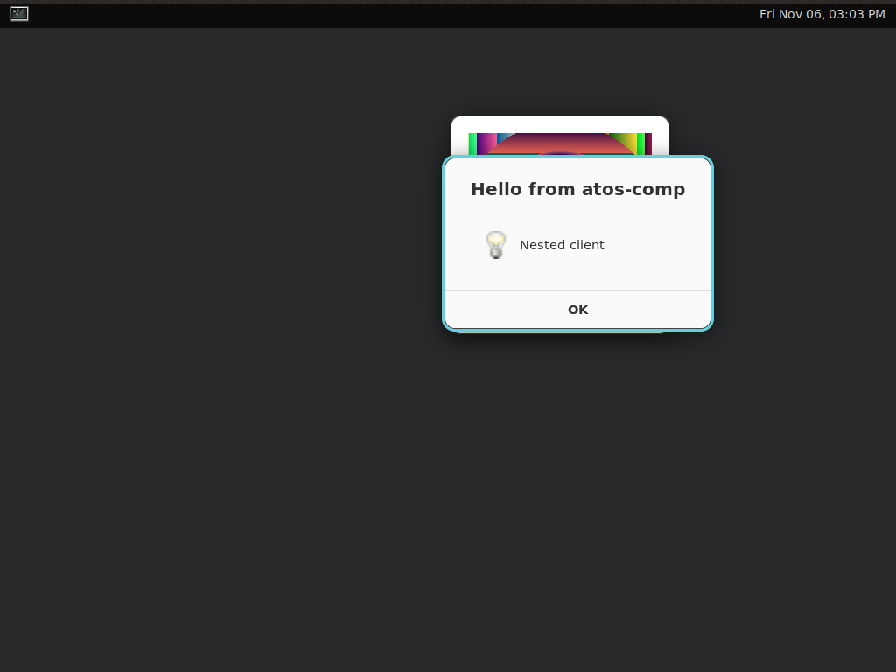

# C2 Compositor: fork of cosmic-comp

Code: `components/c2-compositor/` (crate and binary `atos-comp`). Requirements: [spec §6 C2](../../spec.md#c2-compositor). Decision: D-007 (fork cosmic-comp, renamed; C2 is GPL-3.0-only per D-013).

## Fork point

| | |
| --- | --- |
| Upstream | <https://github.com/pop-os/cosmic-comp> |
| Tag | `epoch-1.11.0` (annotated tag object `f9e5863a804db4c736b436e3247b9cc338e4413a`) |
| Commit | `8cb1802caada438bb5cc7670dfabdaca5fad0502` |
| Taken | 2026-11-06 |
| Method | `git archive` of the tag, committed as a plain snapshot (no upstream history, no submodule, no remote). |

Merging later upstream changes, the security watch and the dependency checks: [upstream.md](upstream.md). D-007: we do not contribute upstream.

## Layout

C2 is its own Cargo workspace (`components/c2-compositor/Cargo.toml` has its own `[workspace]`), not a member of the root workspace. Reasons: its dependency tree (Smithay, libcosmic, git dependencies) and system libraries differ from everything else, and its `Cargo.lock` is upstream's. CI: `.github/workflows/c2-compositor.yml`, which runs only when C2 changes.

Build on Linux (system libraries as in the workflow, or the dev VM):

```sh
cd components/c2-compositor
cargo build --locked && cargo test --locked && cargo clippy --all-targets --locked -- -D warnings
```

## Downstream changes

Every change against `epoch-1.11.0`. No behaviour change except the renamed state directory (last row of Renamed).

### Renamed

| What | From | To |
| --- | --- | --- |
| Package and binary | `cosmic-comp` | `atos-comp` |
| Library crate | `cosmic_comp` | `atos_comp` (used by `src/main.rs` and `examples/`) |
| Config crate and directory | `cosmic-comp-config` | `atos-comp-config` |
| Systemd unit file | `data/cosmic-comp.service` | `data/atos-comp.service` (description and `ExecStart` renamed; it still refers to the removed COSMIC session targets) |
| `--version` / `--help` text, startup log line, debug overlay, logind inhibitor name, log filter target | `cosmic-comp`, "Cosmic starting up!" | `atos-comp`, "Atos compositor starting up!"; help text names Atos as home and credits cosmic-comp by System76 |
| State directory under `$XDG_STATE_HOME` | `cosmic-comp/` | `atos-comp/` (files `outputs.ron`, `numlock.ron`, `a11y_screen_filter.ron`) |
| `Cargo.toml` authors | Victoria Brekenfeld | adds "Atos contributors" |
| `justfile` name | `cosmic-comp` | `atos-comp` |

### Removed

- `.github/` (upstream CI; ours is the workflow above), `debian/`, `flake.nix`, `flake.lock`: packaging belongs to C1 (D-008).
- `rust-toolchain.toml`: the repository root pins the toolchain (D-009).
- Bare-session files `data/cosmic.desktop`, `data/cosmic-service`, `data/cosmic-session.target`, `data/cosmic-session-pre.target` and their `justfile` recipes: session start-up belongs to C1/C3.

### Moved

- `README.md` to `README.upstream.md` (unchanged); `LICENSE` (GPL-3.0) kept as is.

### Deliberately not renamed (not "make no behaviour changes")

These are interfaces shared with COSMIC components or internal names; each is a later decision when C3/C8 replace the COSMIC side:

- Internal libcosmic use (`cosmic`, `cosmic-config`, `cosmic-protocols`, `cosmic-settings-*`, `cosmic-text` dependencies) and Rust type names such as `CosmicSurface`, `CosmicWindow`, `CosmicCompConfig`.
- Config and shortcut IDs (`com.system76.CosmicSettings.*`, the `cosmic-comp` cosmic-config ID inside `atos-comp-config`), the `COSMIC_SESSION_SOCK` environment variable, `cosmic-session` protocol, tiling-exception app IDs in `data/tiling-exceptions.ron`.
- Source comments linking upstream issues and pull requests.

## Dependencies

Four patch bumps in `Cargo.lock` against upstream's lockfile (`anyhow`, `async-executor`, `chacha20`, `rand` 0.10), for RustSec advisories and yanked versions; `license = "GPL-3.0-only"` added to `atos-comp-config/Cargo.toml`. Details: [upstream.md](upstream.md#dependency-checks).

## Demo and measurements

`atos-comp` starts nested (winit backend) inside headless weston in the dev VM and shows client windows (`zenity`, `weston-simple-shm`) on its own socket:



The window frame and top bar are still COSMIC's look (out of scope for this fork, see D-007). Software rendering only in the VM; EGL logs "failed to create dri2 screen" and falls back. No performance numbers: the VM never counts toward the budgets.

Fork changes beyond renaming, needed to pass clippy on the repository toolchain (1.99.1; upstream pins 1.93): `rust-version` raised from 1.93 to 1.99.1; `AtomicUsize::fetch_update` replaced by `try_update` (same semantics, `src/utils/ids.rs`, `src/shell/element/stack.rs`); one needless `&` removed in `src/shell/focus/mod.rs`. The fluent file `resources/i18n/*/cosmic_comp.ftl` is renamed `atos_comp.ftl` (the `fl!` macro names it after the crate).

Build times: cold `cargo build` in the dev VM (aarch64, M1 Max) 1 min 42 s, `cargo clippy` after that 8 s. Hosted CI time: see the first run of the `C2 compositor` workflow in the PR.
