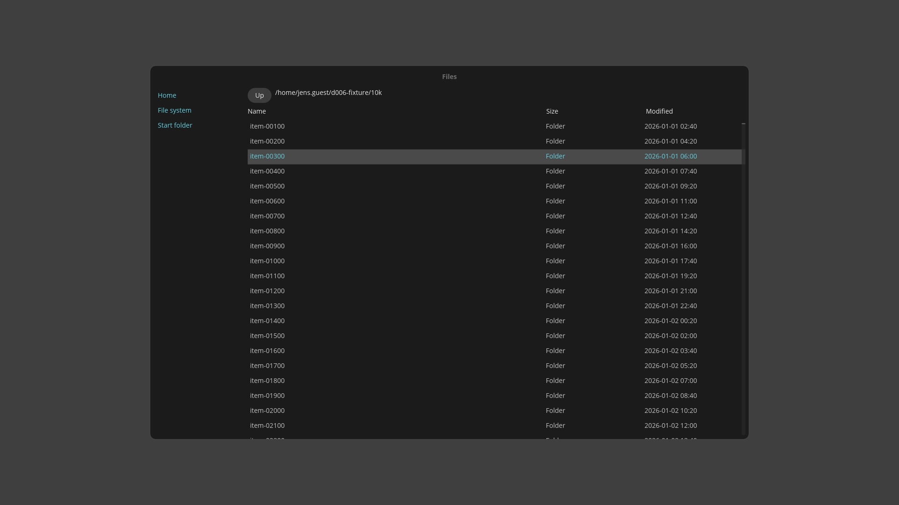

# D-006 spike: Files prototype in libcosmic

Card #10. Implements the Files prototype in [`docs/decisions/D-006-prototype-brief.md`](../../docs/decisions/D-006-prototype-brief.md) §3, and nothing else. Throwaway code: it is not part of the main workspace (it has its own `[workspace]`), and it is not maintained after D-006.



## Build and run

On Linux (in the dev VM: run these through `tools/dev-vm/vm run` from this folder):

```sh
cargo build --release
target/release/d006-iced [start-folder]      # in the VM: $CARGO_TARGET_DIR/release/d006-iced
```

Build needs `libxkbcommon-dev` (for `smithay-client-toolkit`); it was installed in the `atos` VM with `apt-get` for this card. The fixture is [`../d006-fixture/make-fixture.sh`](../d006-fixture/make-fixture.sh), copied unchanged from the brief.

## Facts

| | |
| --- | --- |
| Toolkit | libcosmic git rev [`daca62bb`](https://github.com/pop-os/libcosmic/commit/daca62bb701bdc2cefbf44d6e87dc5d0c2f1835f), the brief's revision, with its bundled pop-os/iced fork. Default features (`winit`, `tokio`, `a11y`, `dbus-config`, `x11`, `wayland`, `multi-window`); nothing changed |
| Renderer | `iced_tiny_skia` (CPU). libcosmic's default features do not include `wgpu`, so the default build never uses the GPU. `--features wgpu` (#36) turns libcosmic's `wgpu` feature on; iced falls back to tiny-skia if wgpu finds no adapter, so the run's renderer line decides what was measured |
| Other dependencies | `jiff` 0.2 (resolves to 0.2.39), for local time in the *Modified* column. libcosmic already depends on it, so it adds no crate |
| Lines of Rust | 560 in `src/main.rs`, blank and comment lines excluded (includes a small size-format test) |
| Crates in `Cargo.lock` | 679 |
| Clean release build | 4 min 06 s wall (dev VM: 4 vCPU on an M1 Max, aarch64, `cargo clean` then `cargo build --release`, dependencies already downloaded). The VM is shared with #11, which may have been building at the same time; #12 measures M9 properly |
| Virtualised list | The fork's `iced::widget::list` (not in upstream iced 0.14); no own virtualisation code |
| `BUDGET_FIRST_FRAME` hook | First message from `iced::window::frames()`. iced_winit broadcasts `RedrawRequested` to subscriptions just before it calls `present()` for that frame, and the message reaches `update()` on a later turn of the event loop, so the line is printed after the first frame was presented. The list lays out its first 50 rows before that first draw |
| Autoscroll driver | `window::frames()` (per-frame callback), `scrollable::scroll_to` on every tick |
| Crashes seen | None, including with `a11y` on |

## Accessibility (`a11y` feature)

The `a11y` feature builds and does **not** crash here (start, navigation, menu, dialog, 10k folder and autoscroll all ran with it on). But the accessibility tree is empty:

- AccessKit registers with AT-SPI only after `org.a11y.Status.ScreenReaderEnabled` is set to true (`IsEnabled` alone is not enough), for example `busctl --user set-property org.a11y.Bus /org/a11y/bus org.a11y.Status ScreenReaderEnabled b true`.
- Then the app shows as `application 'd006-iced'` with one child, `frame ''`: no name and no children.
- Cause, in the fork's `iced/winit/src/lib.rs` at this revision: the adapter's initial tree is a single window node whose label is `String::new()`, and nothing ever calls `UserInterface::a11y_nodes()` or sends a `TreeUpdate`, so widget nodes never reach AccessKit. The widgets do implement `a11y_nodes`.
- Even if they did: of the widgets used, only buttons have a role (`Button`, with `.name()`). There is no list, list item, table, row, menu or menu item role; the `list` widget has no `a11y_nodes` at all, so rows would be missing; and the list is not focusable, so no node can carry `focused` while the list has focus.

So M6 (#12) will find every control in the brief's table missing. No workaround was attempted, as the brief asks.

## What was hard or undocumented

- **Focus and Tab order.** libcosmic's built-in Tab handling (`keyboard_nav`) moves focus in widget-tree order: Home → File system → Start folder → Up. The brief wants sidebar → Up → list, with Up/Down inside the sidebar. The prototype turns `keyboard_nav` off, keeps its own focus state, and moves the toolkit focus with `button::focus(id)`. Nothing documents this; it came from reading `src/app/cosmic.rs`.
- **List focus is not visible on its own.** The list cannot take toolkit focus, so while it has focus no widget shows a focus ring; only the selected row is highlighted. At start (list focused, nothing selected) focus is therefore not visible.
- **Context menu.** libcosmic's `context_menu` opens only on right-click and has no arrow-key navigation, so it cannot meet the keyboard requirements. The menu is a `popover` with three menu-item buttons; Up/Down move the toolkit focus between them. Opened by keyboard it appears at the popover's default position (centre of the window), since the brief places only the right-click menu.
- **Enter is delivered twice.** A focused button handles Enter and the same key event still reaches the app's key subscription (status `Captured`), after the button's message. Without ignoring captured events, *Copy Path* from the menu also opened the row.
- **The virtual list measures rows in batches of 50 per frame.** For 10,000 rows the full scroll height is known after about 200 frames; until then scrolling to the end falls short. Rows have a fixed height (32 px) so that scroll-into-view and Page Up/Down can be computed without the list's layout, which is not readable from outside. The visible page height comes from the scrollable's `on_scroll` viewport, with an estimate until the first scroll.
- **Selected look.** Rows are `button::custom(..).selected(..)` with the `ListItem` class and no `on_press`, inside a `mouse_area` that handles click, double-click and right-click. The `MenuItem` class ignores `selected`; there is no doc saying which classes honour it.
- **API docs.** Most answers came from libcosmic's source and examples, not its rustdoc. The `list` widget and its `Content` type have almost no doc comments.

## Not verified

- Mouse paths (click to select, double-click to open, right-click menu at the pointer, clicking places and *Up*). The headless compositors in the VM (weston, sway with `WLR_LIBINPUT_NO_DEVICES=1`) have no pointer device, and `swaymsg seat … cursor` had no effect. Keyboard paths were checked by injecting keys with `wtype` in headless sway and looking at screenshots, stdout and `wl-paste`.

## Notes for #12

- `wtype` drops the first key after it creates its virtual keyboard: a separate `wtype -k Down` call is often lost. Waiting first (`wtype -s 500 -k Down`) made every key arrive.
- `WAYLAND_DEBUG=client` prints timestamps for this app (`[2103807.362] …`), and autoscroll commits go to one surface.

**Renderer line (#36):** with `D006_RENDERER_PROBE=1` the app asks `iced::system::information()` after the first frame, prints `D006_RENDERER: iced <backend> <adapter>` (`tiny-skia` for the CPU renderer, `Vulkan` and the adapter name for wgpu) on stderr and exits. Normal runs never query it. This needs iced's `sysinfo` feature, enabled through a direct `iced` dependency on the same libcosmic revision.
