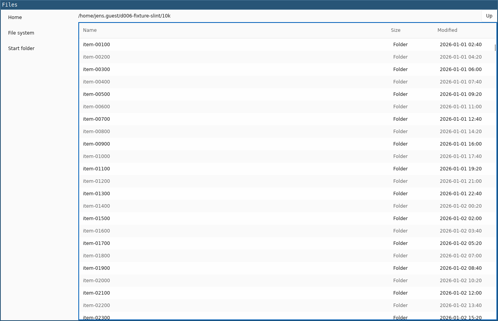

# D-006 spike: Files prototype in Slint

Card #11. Implements exactly section 3 of [`docs/decisions/D-006-prototype-brief.md`](../../docs/decisions/D-006-prototype-brief.md). A throwaway spike: not part of the main workspace, not for merging into product code.

## Build and run

In the dev VM (`docs/dev-environment.md`), from this directory:

```sh
cargo build --release
```

Then run `$CARGO_TARGET_DIR/release/d006-slint [start-folder]` against a Wayland compositor. The fixture is made with `../d006-fixture/make-fixture.sh <new-dir>`.

System packages the build needs, on top of `tools/dev-vm/atos.yaml`: `libfontconfig-dev` and `libxkbcommon-dev` (Slint's documented Linux build dependencies). At run time the femtovg renderer needs OpenGL ES through EGL; in the VM that is Mesa's llvmpipe, already installed with weston.

## Facts for #12 and #14

| | |
| --- | --- |
| Toolkit | Slint `=1.18.1` (`slint` and `slint-build`), default features |
| Licence option | GPL-3.0-only. The spike is not distributed, and this option needs no attribution in the UI (Royalty-free 2.0 would require an "About Slint" or badge, which the brief does not allow). Which option the product would use is a #14 question |
| Backend and renderer | winit backend (Wayland), femtovg renderer (OpenGL ES via EGL). Slint's style: `fluent` (its default on Linux without Qt) |
| Other crates | `chrono =0.4.45` with only the `clock` feature, for `YYYY-MM-DD HH:MM` in local time (the standard library has no time zones). It is already in the tree through `i-slint-core` (`cargo tree -i chrono`), at the same version, so it adds no crate |
| Lines of code | 495, blank and comment lines excluded, after `cargo fmt`: `src/main.rs` 226 (incl. a 12-line unit test), `ui/app.slint` 266, `build.rs` 3 |
| Crates in `Cargo.lock` | 561 (all targets) |
| Clean release build | 183 s wall time in the dev VM (4 vCPU on an M1 Max, aarch64, `cargo clean` then `cargo build --release`). Indicative only; M9 is #12's |
| Binary size | 29.2 MB, 20.7 MB stripped (aarch64) |
| List widget | `StandardTableView`, which is virtualised (it is built on `ListView`). No own virtualisation |

## Measurement hooks

- **`BUDGET_FIRST_FRAME`**: printed and flushed from `Window::set_rendering_notifier` at the first `RenderingState::AfterRendering`. In femtovg that callback runs right before `present_surface` (buffer swap) of the same frame. The rows are in the model before the event loop starts, so the first frame shows them. Only the femtovg and Skia renderers support the notifier; with `SLINT_BACKEND=winit-software` the app stops at start with `renderer must support the rendering notifier`.
- **Autoscroll** (`D006_AUTOSCROLL=1`): driven by `animation-tick()`, Slint's per-frame clock: a property bound to it is re-evaluated every frame, and a `changed` handler sets the table's `content-y` to `elapsed × 2000 px/s`. It starts on a zero-delay timer after the first frame, prints `D006_AUTOSCROLL_DONE` after 10 s (or the end of the list) and exits with status 0. Checked in the VM under sway: exit 0 after about 10.2 s, and `WAYLAND_DEBUG=client` prints millisecond timestamps for `wl_surface.commit`.

## Accessibility (AccessKit)

The `accessibility` feature is on by default and the AT-SPI tree appears. Dumped with `gi.repository.Atspi` in the VM (sway headless):

| Control | Found as | Gap against M6 |
| --- | --- | --- |
| Window | frame `Files` | none |
| Sidebar | list box `Places` | none |
| Places | list item `Home`, `File system`, `Start folder` (focused and selected states work) | none |
| Up button | push button `Up` | none |
| Path label | label with the current path | none |
| File list | table `Files`, focused state works | none |
| Column headers | label `Name`, `Size`, `Modified` | **role is label, not column header** |
| Rows | no row node: each cell is a separate label under an unnamed list box | **no row, no row name, no selected state**. `StandardTableView`'s rows have no `accessible-role`, and Slint 1.18.1 has no table-row role |
| Context menu | a separate frame named `d006-slint` | **role is frame, not menu** |
| Menu items | label `Open`, `Copy Path`, `Properties` (plus an empty label each) | **role is label, not menu item** |
| Properties dialog | panel `Properties` inside an unnamed frame | **no dialog role in Slint 1.18.1**; the prototype uses `groupbox` with the label `Properties` |
| Close button | push button `Close`, focused when the dialog opens | none |

Slint 1.18.1's `AccessibleRole` has no menu, menu item, dialog, row or column header value (`i-slint-common/enums.rs`), so these gaps cannot be closed from app code.

## What was hard or undocumented

1. **Focus visibility of the list.** `StandardTableView` draws no focus indicator and does not report focus (its `has-focus` is never set). The prototype tracks which Tab stop has focus itself and draws a 2 px border in the toolkit's `Palette.accent-background` around the list. The sidebar and the Up button use the toolkit's own focus rings.
2. **Tab order and "focus lands on Home".** There is no focus-changed hook for the table and no way to know where Tab will go, so the prototype handles Tab and Shift+Tab itself (capture phase of a `FocusScope` around the window) with the order sidebar → Up → list, skipping Up while it is disabled at `/`.
3. **Double-click.** `StandardTableView` only forwards raw pointer events per row, without a click count, and Slint has no public double-click interval. The prototype times two left-button presses on the same row itself, with GTK's default 400 ms.
4. **Context menu opens with nothing highlighted.** `ContextMenuArea`'s menu starts with no current item (`current-highlight: -1`, private), so Down first highlights *Open*. To meet the brief (opens with *Open* focused), the app sends one synthetic Down key through the public `Window::dispatch_event` right after opening. This is a workaround, not toolkit behaviour.
5. **Context menu keys.** `ContextMenuArea` opens on the Menu key at its top-left corner even with no row selected, and handles Shift+F10 on Windows only. The prototype disables it and opens it itself for the selected row (Menu key, Shift+F10) and at the pointer (right-click).
6. **Dialog focus after a menu action.** Closing the menu moves focus back to the list after the item's `activated` handler runs, so a dialog opened from there loses keyboard focus. The dialog is opened on a zero-delay timer instead. A `PopupWindow` (with `close-policy: no-auto-close` and a full-window `TouchArea`) serves as the modal dialog; elements inside a `PopupWindow` cannot be accessed from outside it (compile error), so focus goes in through its `forward-focus`.
7. **Clipboard.** Slint has no clipboard API. *Copy Path* puts the path into a hidden `TextInput` and calls its `select-all()` and `copy()`. Checked with `wl-paste`.
8. **Modifiers from a virtual keyboard.** Slint derives Shift, Alt and Control from modifier key events, not from the compositor's modifier state. `wtype -M shift -k Tab` therefore arrives as plain Tab; `wtype -P Shift_L -k Tab -p Shift_L` works.
9. **Element sizing.** Children of a `FocusScope` or `ContextMenuArea` are not laid out; the table and sidebar need `width: 100%; height: 100%`.

## Checked in the VM, and what was not

Under sway headless with `wtype` (keys), `grim` (screenshots) and `wl-paste`, the keyboard behaviour of brief §3 works: list navigation (Up/Down, Page Up/Down, Home/End, Enter, Backspace, Alt+Up), Tab order and the sidebar, the context menu (Menu key, Shift+F10, Up/Down/Enter/Escape and all 3 actions), the modal Properties dialog with Escape, `SPIKE_OPEN`, the 10,000-item folder, the error message for an unreadable folder (`/root`), and autoscroll.

Not checked by automation: **mouse input** (single click, double-click, right-click, clicking a place or *Up*). The headless sway seat has no pointer device and Ubuntu 24.04 has no virtual-pointer tool such as `wlrctl`.

Notes for #12:

- Each `wtype` call creates and removes a virtual keyboard, so the window loses keyboard focus when the call ends. Slint then hides focus rings and AT-SPI shows no `focused` state. Keep a keyboard alive while checking (for example `wtype -s 5000 -k Shift_L &`), and give each call a short delay (`wtype -s 250 ...`), otherwise the first key is lost.
- Python AT-SPI clients sometimes failed with `Couldn't connect to accessibility bus` mid-run, while the bus processes were still running. Dumping once right after start seemed to help; cause not found.


